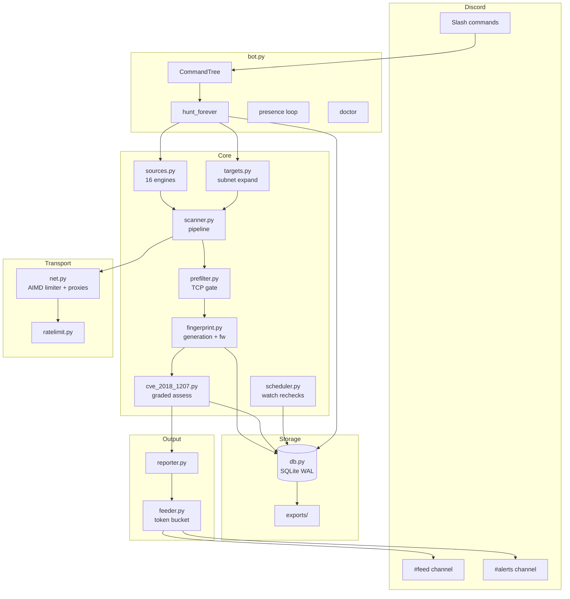
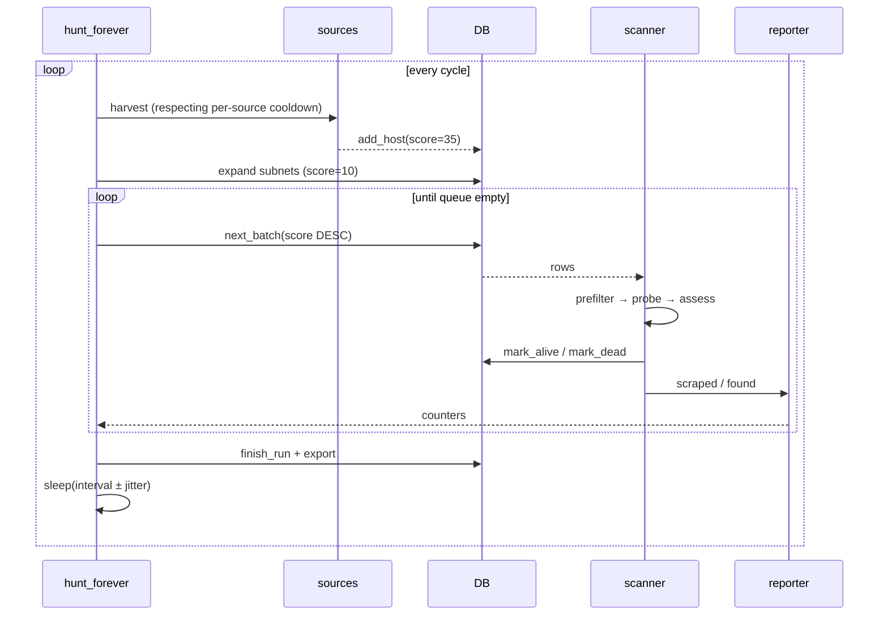

<div align="center">

```
██╗██████╗ ██████╗  █████╗  ██████╗
██║██╔══██╗██╔══██╗██╔══██╗██╔════╝
██║██║  ██║██████╔╝███████║██║
██║██║  ██║██╔══██╗██╔══██║██║
██║██████╔╝██║  ██║██║  ██║╚██████╗
╚═╝╚═════╝ ╚═╝  ╚═╝╚═╝  ╚═╝ ╚═════╝
            H  U  N  T  E  R
```

### **Keyless iDRAC discovery. Continuous. Graded. Loud.**

A Discord-native hunter that finds **iDRAC 6, 7, 8 and 9** exposed on the open internet,
fingerprints each one, extracts firmware, and grades it against **CVE-2018-1207** —
then tells you about it in real time.

[](https://python.org)
[](https://discordpy.readthedocs.io)
[](#-design-principles)
[](#-source-matrix)
[](#-scan-modes)
[](https://nvd.nist.gov/vuln/detail/CVE-2018-1207)

</div>

---

## ▸ Table of Contents

| | |
|---|---|
| [**01 — What this is**](#01--what-this-is) | Purpose and scope |
| [**02 — Why iDRAC**](#02--why-idrac) | The attack surface |
| [**03 — Architecture**](#03--architecture) | Full system design |
| [**04 — Detection pipeline**](#04--detection-pipeline) | How a verdict is reached |
| [**05 — Confidence model**](#05--confidence-model) | Grading, not guessing |
| [**06 — Source matrix**](#06--source-matrix) | All 16 discovery sources |
| [**07 — Scan modes**](#07--scan-modes) | Stealth → Turbo |
| [**08 — Install**](#08--install) | Get it running |
| [**09 — Configuration**](#09--configuration) | Every knob |
| [**10 — Commands**](#10--commands) | Full reference |
| [**11 — Deployment**](#11--deployment) | systemd, Docker |
| [**12 — Data model**](#12--data-model) | Schema and exports |
| [**13 — Tuning**](#13--tuning) | Making it fast, keeping it polite |
| [**14 — Operations**](#14--operations) | Running it 24/7 |
| [**15 — Design principles**](#15--design-principles) | The constraints |
| [**16 — Legal**](#16--legal) | Scope and etiquette |

---

## 01 — What this is

**idrac-hunter is a Discord bot that does four things, continuously:**

```
   ┌─────────────┐    ┌──────────────┐    ┌─────────────┐    ┌──────────────┐
   │   HARVEST   │ →  │  FINGERPRINT │ →  │    GRADE    │ →  │    REPORT    │
   └─────────────┘    └──────────────┘    └─────────────┘    └──────────────┘
    16 keyless           generation,         CVE-2018-1207      live feed,
    engines +           firmware, leak       version + leak     vuln alerts,
    subnet pool         surface, creds       + creds chain      SQLite
```

1. **Harvests** candidate IPs from sixteen keyless sources and your own subnet pool.
2. **Fingerprints** every responder — generation, model, firmware, whether it leaks unauthenticated endpoints, whether `root:calvin` still works.
3. **Grades** each iDRAC against CVE-2018-1207 with a confidence tier.
4. **Reports** every scraped host to a feed channel and every vulnerable one to an alert channel.

It runs forever. It survives restarts. It costs nothing to operate — no Shodan plan, no FOFA credits, no Censys subscription.

> **It is a triage tool, not an exploit.** Nothing is written to, reset, or rebooted on a target. Everything is GET plus one POST to `/data/login`.

---

## 02 — Why iDRAC

A baseboard management controller is the machine *underneath* the machine. It has its own NIC, its own OS, its own credentials, and full out-of-band control: power, virtual media, console, firmware. Compromise it and the host's OS, disk encryption, and hypervisor all become decorative.

iDRAC is Dell's BMC. It ships on every PowerEdge. And a very large number of them are pointed at the public internet, because someone wanted remote console access and opened 443 on the edge firewall instead of building a VPN.

**CVE-2018-1207** is a command-injection and privilege-escalation chain in the iDRAC7/iDRAC8 web stack, fixed in firmware `2.40.40.40`. An iDRAC below that build, reachable from the internet, is a complete server takeover waiting on a request. The iDRAC6 line is EOL and predates the fix entirely.

There is no clean single-shot unauthenticated probe that proves this CVE. So this tool does what an analyst does: reads the version, and cross-references it.

---

## 03 — Architecture

### Process topology



### Repository layout

```
idrac-hunter/
│
├── bot.py                  ◀ entrypoint — commands, loops, event wiring
├── config.yaml             ◀ runtime configuration
├── requirements.txt
│
├── core/
│   ├── config.py           ◀ dataclass config + the four mode profiles
│   ├── db.py               ◀ SQLite schema, migrations, exports
│   ├── net.py              ◀ pooled session, UA rotation, proxy rotation
│   ├── ratelimit.py        ◀ AIMD limiter (backs off on 429/503)
│   ├── prefilter.py        ◀ raw TCP connect gate
│   ├── targets.py          ◀ CIDR/range parsing, deterministic sampling
│   ├── fingerprint.py      ◀ generation markers, firmware extraction
│   ├── cve_2018_1207.py    ◀ leak probes + version compare + grading
│   ├── sources.py          ◀ 16 keyless engines
│   ├── scanner.py          ◀ per-host pipeline
│   ├── scheduler.py        ◀ watch recheck loop
│   ├── reporter.py         ◀ scanner → feed bridge
│   ├── feeder.py           ◀ batched Discord output, own rate limiter
│   ├── metrics.py          ◀ cycle history, sparklines
│   ├── doctor.py           ◀ startup self-check
│   ├── state.py            ◀ in-memory hunt state
│   └── ui.py               ◀ embeds, pagination, colour system
│
├── subnets.txt             ◀ your manual ranges
├── datacenter_subnets.txt  ◀ hosting/colo ranges (optional)
├── asns.txt                ◀ ASNs for live prefix derivation (optional)
├── Dockerfile
└── systemd/idrac-hunter.service
```

### Cycle lifecycle



---

## 04 — Detection pipeline

Every candidate passes through a fixed gate. Nothing is alerted on until it clears all of it.

### Stage 1 — Prefilter

```
TCP connect → 443 | 80 | 8443 | 5900 | 5901 | 623
```

Raw `asyncio.open_connection` with a short timeout. Dead space never touches the HTTP layer. Roughly two orders of magnitude cheaper than probing blind.

### Stage 2 — Fingerprint

Eight paths walked: `/`, `/login.html`, `/index.html`, `/data/login`,
`/restapi/v1/Systems`, `/redfish/v1/`, `/cgi-bin/webcgi/`, `/session`.

| Signal | Weight | Notes |
|---|---:|---|
| Generation marker (`idrac7`, `DRAC 6`) | **+70** | decisive |
| Branded title | +20 | corroborating |
| Generic `idrac` string | +30 | not sufficient alone |
| Firmware extracted | +15 | feeds stage 4 |
| `root:calvin` accepted | +45 | strong |
| Confirmed candidate bonus | +25 | |

**Gate: score ≥ 40.** A bare `idrac` string alone never qualifies.

Generation is assigned only from a branded string or exclusive endpoint shape — `/cgi-bin/webcgi` is iDRAC6-only, `/restapi` is iDRAC9-only. Generic markers leave the generation at `0`.

### Stage 3 — Leak surface

Seven endpoints that *should* require authentication:

```
/data?get=prodVersion     /data?get=macs          /data?get=all
/cgi-bin/webcgi/version   /restapi/v1/Systems
/redfish/v1/Managers/iDRAC.Embedded.1             /session?redirect=1
```

Each is counted, not merely checked. A response carrying the expected marker scores a hit. Any `<prodVersion>` in a response is harvested.

### Stage 4 — Assessment

```python
gen in (7, 8):
    firmware < 2.40.40.40   →  CONFIRMED
    firmware >= 2.40.40.40  →  patched
    no firmware + leaks/creds →  LIKELY
    no firmware, no signals →  SUSPECT

gen 9:
    firmware < 3.21.21.21   →  LIKELY
    otherwise               →  patched

gen 6:                      →  SUSPECT   (EOL, predates fix)
gen 0:                      →  unknown
```

---

## 05 — Confidence model

| Tier | Meaning | Alerted by default |
|---|---|:---:|
| 🔴 **CONFIRMED** | Firmware parsed and below the fixed build | ✅ |
| 🟠 **LIKELY** | Affected family, build unreadable, but leak surface or default creds fired | ✅ |
| 🟡 **SUSPECT** | Affected family with no corroboration, or EOL generation | ❌ |
| ⚪ **PATCHED** | At or above the fixed build | ❌ |
| ⚫ **UNKNOWN** | No generation identified | ❌ |

Adjust the alert floor with `/config alerts #channel min_confidence:confirmed`.

---

## 06 — Source matrix

Sixteen sources. All keyless. All HTML-scraped or public API.

| # | Source | Type | Reliability |
|---:|---|---|---|
| 1 | Shodan | engine | ▰▰▰▰▱ |
| 2 | FOFA | engine | ▰▰▰▰▱ |
| 3 | ZoomEye | engine | ▰▰▰▱▱ |
| 4 | Quake (360) | engine | ▰▰▱▱▱ |
| 5 | Hunter (QAX) | engine | ▰▰▰▱▱ |
| 6 | Netlas | engine | ▰▰▰▱▱ |
| 7 | Censys | engine | ▰▰▰▱▱ |
| 8 | Onyphe | engine | ▰▰▱▱▱ |
| 9 | DuckDuckGo | dork | ▰▰▰▰▱ |
| 10 | Bing | dork | ▰▰▰▱▱ |
| 11 | Mojeek | dork | ▰▰▰▰▱ |
| 12 | Yahoo | dork | ▰▰▰▱▱ |
| 13 | crt.sh | CT | ▰▰▱▱▱ |
| 14 | HackerTarget | CT | ▰▰▱▱▱ |
| 15 | Shodan InternetDB | enrich | ▰▰▰▰▰ |
| 16 | ip-api | enrich | ▰▰▰▰▰ |

> **Reality check.** The single-engine sites are SPAs and their HTML breaks. Broken sources are isolated — five consecutive failures trigger exponential backoff up to 12×, and `/config sources` shows live health plus yield per source. **The reliable path is subnets + Shodan + FOFA + the dork engines.** `crt.sh` and `HackerTarget` are near-useless for iDRAC specifically, because iDRAC certificates are self-signed and mostly invisible to certificate transparency.

---

## 07 — Scan modes

| | 🌙 **Stealth** | ⚙️ **Normal** | ⚡ **Turbo** | 🔬 **Deep** |
|---|---:|---:|---:|---:|
| Concurrency | 40 | 250 | 1200 | 300 |
| Per-host delay | 0.6 s | 0.15 s | 0 | 0.1 s |
| Prefilter | ✗ | ✓ | ✓ | ✓ |
| Sample / subnet | 1 024 | 4 096 | 16 384 | 65 536 |
| Engines | ✓ | ✓ | ✗ | ✓ |
| Leak probes | ✓ | ✓ | ✗ | ✓ |
| Credential check | ✓ | ✓ | ✗ | ✓ |
| Enrichment | ✓ | ✓ | ✗ | ✓ |

- **Stealth** — every check, no prefilter, low rate. Use against fragile targets or when the engines are rate-limiting you.
- **Normal** — the default. Balanced.
- **Turbo** — raw subnet throughput. Finds hosts, does not grade them.
- **Deep** — full expansion, every source, every probe.

Mode persists across restarts. `/idrac mode` switches live, mid-cycle.

---

## 08 — Install

### Requirements

- Python **3.11+**
- A Discord application with a bot token
- Outbound TCP 443/80/8443/5900/5901/623

### Steps

```bash
git clone <your-repo> idrac-hunter
cd idrac-hunter

python3 -m venv venv
source venv/bin/activate          # Windows: venv\Scripts\activate
pip install -r requirements.txt

cp config.yaml.example config.yaml
```

Edit `config.yaml`:

```yaml
bot_token: "YOUR_TOKEN"
guild_id: 123456789012345678     # your server ID — instant command sync
```

Run:

```bash
python bot.py
```

Then in Discord:

```
/doctor                          # verify the install
/config feed    #feed level:all
/config alerts  #alerts min_confidence:likely
/idrac start mode:normal
```

### Discord setup

1. [Developer Portal](https://discord.com/developers/applications) → **New Application**
2. **Bot** → **Reset Token** → copy into `config.yaml`
3. **OAuth2 → URL Generator** → scopes `bot`, `applications.commands`
4. Permissions: `Send Messages`, `Embed Links`, `Attach Files`, `Read Message History`
5. Invite, then run `/sync` once

---

## 09 — Configuration

| Key | Default | Description |
|---|---|---|
| `bot_token` | — | Bot token (or `DISCORD_TOKEN` env) |
| `guild_id` | `0` | Guild for instant sync; `0` = global |
| `default_mode` | `normal` | Starting mode |
| `default_ports` | `[443, 80, …]` | Scanned ports |
| `default_gens` | `[6, 7, 8, 9]` | Reported generations |
| `default_feed_level` | `all` | `off` / `vuln` / `idrac` / `all` |
| `default_notify_min` | `likely` | Alert floor |
| `source_interval_hours` | `6` | Per-source cooldown |
| `source_result_limit` | `500` | Max IPs per source per run |
| `rescan_alive_hours` | `168` | Alive non-vuln recheck |
| `rescan_dead_hours` | `720` | Dead recheck ceiling |
| `rescan_vuln_hours` | `24` | Vuln recheck |
| `watch_interval_minutes` | `180` | `/watch` recheck interval |
| `cycle_interval` | `600` | Seconds between cycles |
| `cycle_jitter` | `180` | Random cycle spread |
| `use_datacenters` | `false` | Sweep `datacenter_subnets.txt` |
| `use_asn_harvest` | `false` | Derive live prefixes from `asns.txt` |
| `proxy_file` | `""` | One proxy URL per line |
| `log_level` | `INFO` | `DEBUG` for tracing |

Runtime settings stored in SQLite override config defaults: `mode`, `ports`, `gens`, `feed_level`, `notify_min`, `alert_channel`, `feed_channel`, `running`.

---

## 10 — Commands

### `/idrac` — control

| Command | Description |
|---|---|
| `/idrac start [mode]` | Begin the 24/7 loop |
| `/idrac stop` | Halt the loop |
| `/idrac status` | Phase, progress, counters, generation spread, trend |
| `/idrac mode <mode>` | Switch mode live |
| `/idrac generations <csv>` | Report only these gens |
| `/idrac priority` | Requeue every vulnerable host |

### `/scan` — manual

| Command | Description |
|---|---|
| `/scan cidr <target> [full]` | Sweep a CIDR, range or IP |
| `/scan ip <host> [port]` | Single target, returns full record |
| `/scan file <attachment>` | Sweep an uploaded `.txt` |

Manual scans run on their own state object, so a running hunt's counters are never disturbed.

### `/subnets` — pool

`/subnets add <targets>` · `remove <cidr>` · `list` · `clear`

### Data

`/vulns [confidence]` · `/hosts [status] [generation]` · `/lookup <ip>` ·
`/stats` · `/export <kind>` · `/watch <ip>` · `/unwatch <ip>`

### `/config`

`alerts <channel> [min_confidence]` · `feed <channel> [level]` ·
`ports <csv>` · `sources`

### Utility

`/doctor` · `/ping` · `/help` · `/sync`

---

## 11 — Deployment

### systemd

```bash
sudo cp -r . /opt/idrac-hunter
sudo useradd -r -s /usr/sbin/nologin hunter
sudo chown -R hunter:hunter /opt/idrac-hunter
sudo -u hunter python3 -m venv /opt/idrac-hunter/venv
sudo -u hunter /opt/idrac-hunter/venv/bin/pip install -r /opt/idrac-hunter/requirements.txt

sudo cp systemd/idrac-hunter.service /etc/systemd/system/
sudo sed -i 's/your_token/YOUR_REAL_TOKEN/' /etc/systemd/system/idrac-hunter.service
sudo systemctl daemon-reload
sudo systemctl enable --now idrac-hunter
journalctl -u idrac-hunter -f
```

### Docker

```bash
docker build -t idrac-hunter .
docker run -d --name idrac-hunter \
  --restart unless-stopped \
  -e DISCORD_TOKEN=YOUR_TOKEN \
  -v "$PWD/data:/app/data" \
  -v "$PWD/config.yaml:/app/config.yaml:ro" \
  idrac-hunter
```

### Raising limits

Turbo mode opens 1 200 sockets. Default `nofile` is often 1 024.

```bash
ulimit -n 65535
# systemd: LimitNOFILE=65535 (already set in the unit file)
```

---

## 12 — Data model

SQLite, WAL, at `data/idrac.db`.

### `hosts`

`ip` `port` `scheme` `first_seen` `last_seen` `sources` `status` `attempts`
`next_scan` `generation` `model` `title` `server` `firmware` `default_creds`
`auth_bypass` `country` `asn` `org` `score` `confidence` `evidence` `notes`

### `vulns`

`ip` `port` `cve` `confidence` `method` `evidence` `generation` `firmware`
`confirmed_at` `last_checked`

### Supporting

`subnets` · `watches` · `source_stats` · `runs` · `settings`

### Exports → `data/exports/`

`all_ips.txt` · `all_hosts.csv` · `idrac_hosts.csv` · `vuln_ips.txt` ·
`vulns.csv` · `vulns.jsonl` · `bundle.zip`

Written automatically at the end of every cycle. `/export` delivers any of them to Discord.

---

## 13 — Tuning

**Make it faster.** Turbo mode, raise `concurrency`, drop `per_host_delay` to 0, add `5900` to ports. Reduce `source_interval_hours` so harvesting runs more often.

**Make it politer.** Stealth mode, `per_host_delay: 1.0`, lower `source_result_limit`, raise `cycle_interval`.

**Make it wider.** `use_datacenters: true` sweeps the colo list. `use_asn_harvest: true` derives live prefixes from `asns.txt` via ip2asn weekly. Note that cloud giants (AWS/GCP/Azure) are deliberately partial — full coverage makes a cycle enormous.

**Make it quieter.** `/config feed #feed level:idrac` reports only confirmed iDRACs. `level:vuln` reports only vulnerable ones. `level:off` disables the feed and leaves only alerts.

**Cut the noise entirely.** `/idrac generations 7,8` — excluded generations are not scanned at all, which saves a lot of requests on a corpus dominated by iDRAC9.

---

## 14 — Operations

**Restart safety.** `running` is persisted to SQLite. If the process dies mid-hunt, it resumes on boot. `recover_stuck()` flips orphaned `scanning` rows back to `retry`.

**Retry backoff.** Failures schedule `2^attempts` hours, capped at `rescan_dead_hours`, and give up at 8 attempts.

**Watch loop.** `/watch` targets are requeued every `watch_interval_minutes` at score 90 — the front of the queue.

**Rate-limit defence.** The HTTP layer uses an AIMD limiter: halve on 429/503, +2 % per success. The Discord feeder has its own bucket and self-disables for 15 s after a 429 rather than burning the connection.

**Health.** `/doctor` checks token, library versions, DB writability, disk space, export directory. `/config sources` shows per-source health and cumulative yield.

**Logs.** `data/idrac.log`, rotated at 10 MB × 3.

---

## 15 — Design principles

**No API keys.** Every source is public HTML or a public API. Nothing to rotate, nothing to expire, nothing to bill. The trade is fragility — sources break, and the backoff logic absorbs it.

**Nothing is written to targets.** GET everywhere, one POST to `/data/login` with `root:calvin`. Safe against production BMCs.

**Behaviour over banners.** Generation comes from endpoint shape and branded markers, not a single string. Verdicts come from parsed firmware, not a guess.

**Grade, don't guess.** Five confidence tiers with an explicit alert floor. `confirmed` means a build number was read and compared. `suspect` means it's a family member and nothing more.

**Fail small.** A broken source costs one source. A dead host costs one host. A crashed cycle logs and waits 30 s.

**Politeness is a feature.** Per-host delay, per-source cooldowns, cycle jitter, adaptive throttling. Getting blocked is a bug, not a cost of doing business.

---

## 16 — Legal

Scanning is **active** — the tool makes real requests to hosts it does not own. Unauthenticated GETs and a single login POST against a BMC are low-impact and broadly tolerated, but "broadly tolerated" is not "authorised". If you need certainty, read your jurisdiction's rules and the target's own policy.

Findings are **point-in-time**. A patched iDRAC can be downgraded; an unreachable one can come back. Re-verify before you report.

Firmware version comparison is **heuristic**. `2.40.40.40` is the published fixed build for iDRAC7/8; if Dell revises, update `FIXED_7_8` in `core/cve_2018_1207.py`.

---

<div align="center">

```
        ▰▰▰▰▰▰▰▰▰▰▰▰▰▰▰▰▰▰▰▰▰▰▰▰▰▰▰▰▰▰▰▰▰▰▰▰▰▰▰▰▰▰▰▰▰
```

**Built for the people who read the firmware string.**

*If it finds something worth patching, go tell the owner.*

</div>
